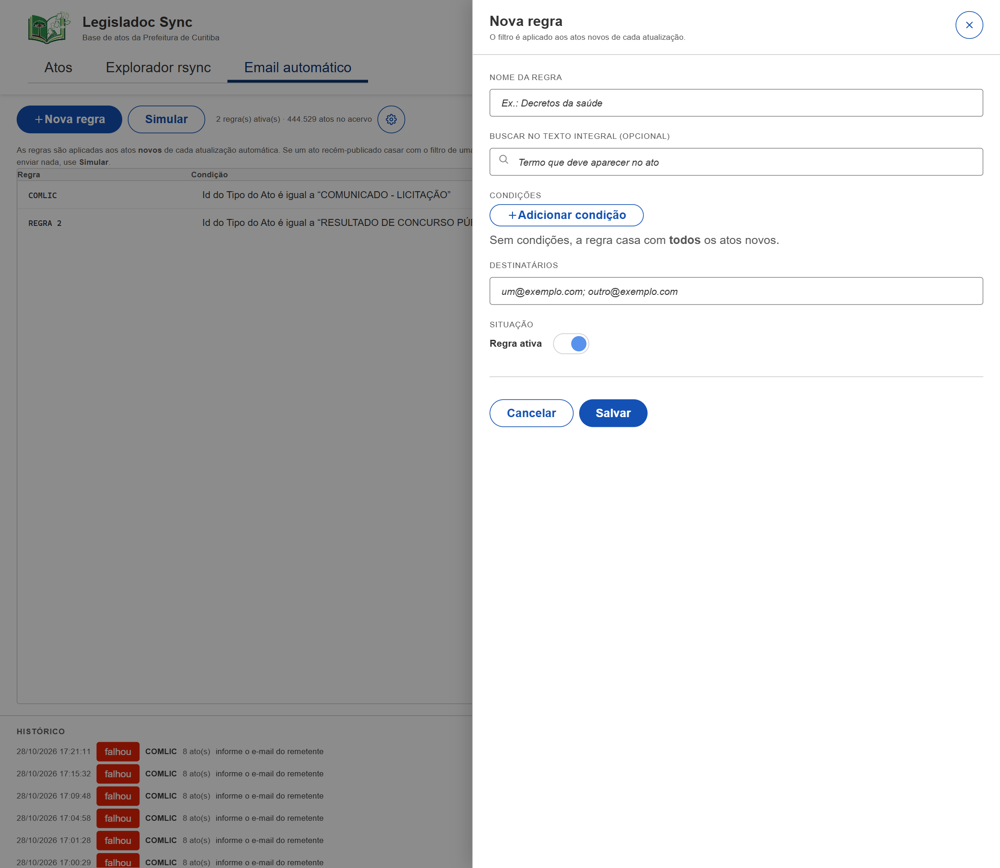
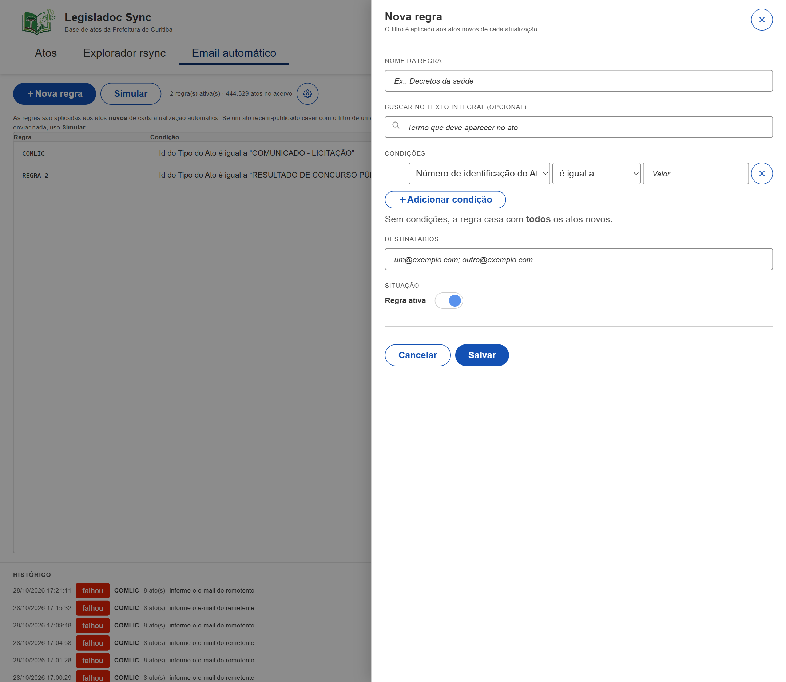
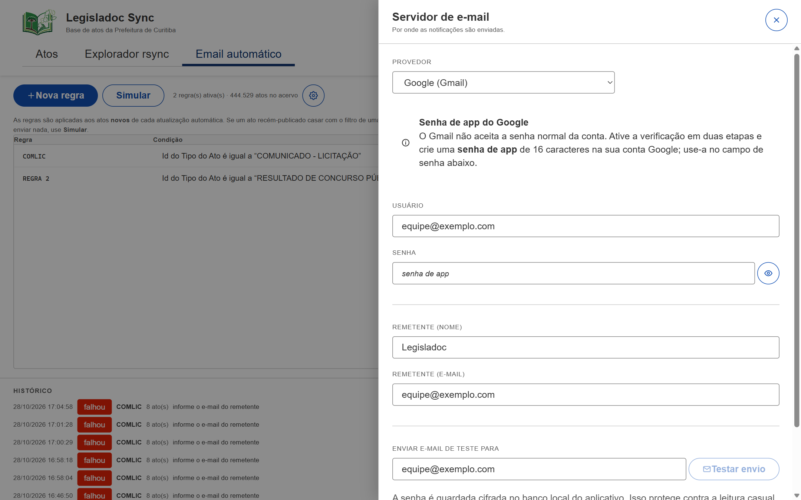
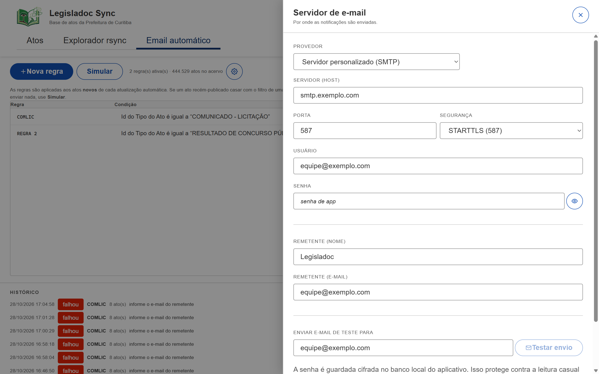

# Legisladoc Sync

[English](README.en.md) · **Português (BR)**

Aplicativo desktop para consultar, buscar e monitorar o acervo de atos do
**Legisladoc** publicado pela Prefeitura de Curitiba. Ele espelha a listagem
rsync do feed, mantém um índice SQLite local com busca em texto integral e pode
enviar por e-mail os atos recém-publicados que correspondam a regras salvas.


## Sumário

- [Como usar](#como-usar)
  - [Primeira execução](#primeira-execução)
  - [Atos](#atos)
  - [Explorador rsync](#explorador-rsync)
  - [Email automático](#email-automático)
  - [Criando uma regra](#criando-uma-regra)
  - [Gmail via SMTP com senha de app](#gmail-via-smtp-com-senha-de-app)
  - [Dados locais e privacidade](#dados-locais-e-privacidade)
  - [Janela, bandeja e segundo plano](#janela-bandeja-e-segundo-plano)
- [Guia do desenvolvedor](#guia-do-desenvolvedor)
  - [Stack](#stack)
  - [Requisitos](#requisitos)
  - [Como começar](#como-começar)
  - [Estrutura do projeto](#estrutura-do-projeto)
  - [Como a sincronização funciona](#como-a-sincronização-funciona)
  - [Modelo de dados](#modelo-de-dados)
  - [Testes](#testes)
  - [Solução de problemas](#solução-de-problemas)
- [Dependências usadas](#dependências-usadas)
- [Licença](#licença)

## Como usar

### Primeira execução

O aplicativo lê o feed público em
`rsync://dadosabertos.c3sl.ufpr.br/dadosabertos/curitiba/Legisladoc/` e o
espelha em um banco de dados local.

1. Abra o **Legisladoc Sync**. A primeira carga lê o acervo inteiro de atos
   (cerca de 1,4 GB) e o indexa, o que pode levar alguns minutos dependendo da
   conexão. Uma tela de preparação mostra cada fase: verificando a origem,
   lendo os campos, baixando/indexando e buscando os atos novos.
2. A pastilha de status no cabeçalho mostra o que aconteceu por último: "Ainda
   não sincronizado", "Atualizado há 2 minutos · +120 atos novos" ou uma
   mensagem de erro.
3. Escolha a frequência de atualização em **Automático** (15 min, 30 min, 1 h,
   3 h ou 12 h; padrão 1 h). **Atualizar agora** força uma atualização.
4. As atualizações seguintes são incrementais: se o arquivo de atos publicado
   tiver o mesmo tamanho e ETag, nada é baixado; caso contrário, apenas as
   linhas com ID acima do máximo armazenado são mescladas ao índice local.

> A primeira carga e as recargas completas **não** enviam notificações por
> e-mail. Elas apenas estabelecem a linha de base ("watermark") a partir da qual
> os atos novos são contados.

### Atos

A aba inicial lista os atos publicados com busca em texto integral.

- Digite na caixa de busca (ou pressione `Ctrl+F`) para pesquisar no texto
  integral dos atos. Os trechos correspondentes aparecem destacados na última
  coluna.
- Use os quatro filtros — montados a partir dos rótulos de campo do próprio
  feed: tipo do ato, órgão de origem, situação atual e ano de publicação — para
  reduzir a lista. Os valores e as contagens vêm do banco local. Um filtro fica
  desabilitado quando o feed não define valores para aquela coluna.
- Clique no cabeçalho de uma coluna para ordenar; clique de novo para inverter.
  A lista mostra 100 atos por página.
- Clique em uma linha (ou foque-a e pressione `Enter`) para abrir a gaveta de
  detalhes com todos os campos do feed, o corpo do ato e uma caixa para enviar
  aquele ato por e-mail.
- `Esc`/o botão de fechar dispensa a gaveta.


### Explorador rsync


Uma visão crua do que o servidor publica — inclusive os arquivos que o
aplicativo não interpreta — para conferir se a cópia local está atualizada.

- Quatro indicadores resumem o acervo: atos publicados, arquivos na origem,
  volume total e arquivos alterados no último dia.
- Busque nomes de arquivo, ordene por arquivo/tamanho/data de modificação e
  confira a coluna **Sincronizado** para ver quais arquivos já foram ingeridos.
  Arquivos alterados nos últimos 7 dias recebem a etiqueta **novo**.
- O rodapé mostra o caminho completo do arquivo selecionado.

### Email automático


Dois conceitos convivem aqui: **regras** (um filtro salvo, com destinatários e
um liga/desliga) e a **configuração de SMTP**, atrás do botão de engrenagem.

1. Abra a engrenagem (**Configurar servidor de e-mail**) e preencha o servidor
   SMTP. Para o Gmail, siga o passo a passo abaixo.
2. **Nova regra** cria uma regra: um nome, um termo opcional de texto integral,
   uma ou mais condições (coluna, operador, valor, combinadas com `e`/`ou`),
   destinatários separados por `;` ou `,` e o interruptor **Regra ativa**.
3. As regras rodam após uma sincronização **automática**, sobre os atos
   acrescentados desde a última notificação. Uma regra que casa envia um
   e-mail listando até 100 atos; se houver mais, a mensagem informa quantos
   ficaram de fora em vez de enviar milhares de linhas.
4. **Simular** executa todas as regras ativas sobre **todo o acervo**, para você
   conferir os filtros sem enviar nada.
5. **Histórico** lista as últimas notificações por regra, incluindo execuções
   ignoradas e com falha, com a mensagem de erro.

Uma atualização manual (**Atualizar agora**) nunca envia e-mail: os atos que
casam com as regras aparecem em um alerta dentro do aplicativo.

### Criando uma regra



1. Abra **Email automático** e clique em **+ Nova regra**.
2. **Nome da regra**: um rótulo curto e reconhecível, por exemplo
   `Decretos da saúde`.
3. **Buscar no texto integral (opcional)**: um termo que precise aparecer no
   texto do ato. Deixe vazio para não exigir termo.
4. **Condições**: clique em **+ Adicionar condição** para filtrar por coluna.
   Cada condição tem **Coluna** (os campos que o feed permite filtrar),
   **Operador** (é igual a, é diferente de, contém, maior ou igual a, menor ou
   igual a) e **Valor**. A partir da segunda condição aparece o **Conector**
   (`e` ou `ou`). Sem nenhuma condição, a regra casa com **todos** os atos
   novos.
5. **Destinatários**: separe os endereços por `;` ou `,`, por exemplo
   `equipe@exemplo.com; chefe@exemplo.com`.
6. **Regra ativa**: deixe ligado para a regra ser aplicada; desligue para
   guardá-la sem enviar nada.
7. Clique em **Salvar**. A regra entra na lista com o filtro resumido na coluna
   **Condição**.
8. Use **Simular** para testar a regra sobre **todo o acervo** antes de confiar
   nela, e confira **Histórico** depois de cada atualização automática.



As regras são avaliadas apenas sobre os atos **novos** de cada atualização
automática; a primeira carga não envia nada e uma atualização manual apenas
mostra o alerta na tela.

### Gmail via SMTP com senha de app

O Gmail não aceita a senha normal da conta por SMTP. É preciso usar uma **senha
de app de 16 caracteres**, que por sua vez exige a verificação em duas etapas.

1. Entre na conta Google que enviará as mensagens.
2. Ative a verificação em duas etapas: <https://myaccount.google.com/security> →
   **Como você faz login no Google** → **Verificação em duas etapas**. As senhas
   de app não são oferecidas enquanto a verificação estiver desligada.
3. Abra <https://myaccount.google.com/apppasswords>.
4. Informe um nome como `Legisladoc Sync` e clique em **Criar**.
5. Copie a senha de 16 caracteres exibida (os espaços são ignorados). O Google
   a mostra apenas uma vez; se perdê-la, crie outra.
6. No aplicativo, abra **Email automático** → ícone de engrenagem.
7. Defina **Provedor** como **Google (Gmail)**. Servidor, porta e segurança são
   preenchidos automaticamente: `smtp.gmail.com`, porta `587`, `STARTTLS`.
8. Preencha:
   - **Usuário**: o endereço Gmail completo (por exemplo `nome@gmail.com`).
   - **Senha**: a senha de app de 16 caracteres (não a senha da conta).
   - **Remetente (nome)** e **Remetente (e-mail)**: o que os destinatários verão.
     O e-mail deve ser a mesma conta, ou um alias configurado no Gmail.
9. Clique em **Salvar** e depois em **Testar conexão**. Uma mensagem de sucesso
   significa que o TLS e a autenticação funcionaram.
10. Digite um destino em **Enviar e-mail de teste para** e clique em
    **Testar envio** para confirmar o caminho completo.



Com o preset Google, servidor, porta e segurança são preenchidos
automaticamente, e a gaveta lembra que o Gmail exige uma senha de app de 16
caracteres.

**Usando outro servidor SMTP.** Se não for Gmail, escolha **Servidor
personalizado (SMTP)** e informe o servidor manualmente:



- **Servidor (host)** e **Porta**: o endpoint SMTP; **Segurança** é `STARTTLS`
  na porta 587, `TLS` na 465, ou `Sem TLS` apenas para um relay local.
- **Usuário** e **Senha**: as credenciais SMTP. A senha é guardada cifrada
  (AES-256-GCM) e nunca é exibida novamente.
- **Remetente (nome/e-mail)**: o que os destinatários veem. Alguns servidores
  exigem que esse endereço coincida com a conta autenticada.
- Use sempre **Testar conexão** antes de salvar e depois **Testar envio**.

Observações e limites:

- Se **Senhas de app** não aparecer, a conta pertence a um domínio do Google
  Workspace cujo administrador desativou o recurso, ou o Programa de Proteção
  Avançada está ativo. Nesse caso, use um relay SMTP próprio ou uma conta que
  permita senhas de app.
- A opção antiga "acesso a apps menos seguros" não existe mais e não pode ser
  usada.
- O Gmail aplica cotas diárias de envio (contas gratuitas: cerca de 500
  destinatários por dia; contas Workspace têm limites maiores). Mantenha as
  regras específicas para ficar bem abaixo delas.
- A senha de app pode ser revogada a qualquer momento na mesma página do
  Google; apague-a lá e crie outra para o aplicativo.
- A senha é guardada cifrada (AES-256-GCM) no banco local, com a chave em
  `email.key` ao lado dele. Isso protege um arquivo `.sqlite` copiado, mas não
  um invasor local que consiga ler todo o seu perfil de usuário.

### Dados locais e privacidade

Tudo roda localmente. O aplicativo conversa apenas com o feed/espelho do
Legisladoc e com o servidor SMTP que você configurar.

- Banco de dados: `%APPDATA%\com.cwbapplab.legisladoc-sync\legisladoc.sqlite`
- Chave de cifra da senha SMTP: `email.key` no mesmo diretório
- Logs: gravados pelo `tauri-plugin-log` no diretório de logs da aplicação
- Sem telemetria, analytics ou servidores de terceiros além dos citados

### Janela, bandeja e segundo plano

Fechar a janela não encerra o aplicativo: ele vai para a bandeja do sistema para
que a atualização automática e as regras de e-mail continuem rodando. Uma
notificação avisa que ele segue em segundo plano.

- **Clique com o botão esquerdo** no ícone da bandeja para reabrir a janela.
- **Clique com o botão direito** para abrir o menu: **Abrir Legisladoc Sync**
  (igual ao clique esquerdo) e **Sair**, que encerra o aplicativo e suas
  sincronizações agendadas.

Use **Sair** quando quiser realmente encerrar; o botão de fechar da janela
apenas a esconde.

## Guia do desenvolvedor

### Stack

- **Shell:** [Tauri 2](https://tauri.app) (backend Rust + WebView2 do sistema)
- **Front end:** React 19 + TypeScript, empacotado pelo Vite 8
- **UI:** [GOVBR-DS](https://www.gov.br/ds/) (`@govbr-ds/core`)
- **Armazenamento:** SQLite compilado no binário (`rusqlite` com `bundled`),
  incluindo FTS5 para busca em texto integral
- **HTTP:** `ureq` com rustls (espelho do feed)
- **rsync:** `arrsync`, vendorizado em `src-tauri/vendor/arrsync` com uma
  pequena correção para Windows
- **E-mail:** `lettre` (SMTP + STARTTLS/TLS)

### Requisitos

- Windows 10/11 x64 (o runtime WebView2 já vem no Windows 11 e em Windows 10
  atualizado)
- [Node.js](https://nodejs.org) 20.19+ ou 22.12+ (exigência do Vite 8)
- Rust estável com a toolchain MSVC e a carga de trabalho **Desenvolvimento
  para desktop com C++** do Visual Studio Build Tools
- Cerca de 3 GB livres em disco para o banco local após a primeira carga

### Como começar

```powershell
npm install
npm run tauri dev      # Vite em :1420 + a janela do Tauri
```

Outros scripts:

| Comando | O que faz |
| --- | --- |
| `npm run dev` | Apenas o servidor do Vite (o front no navegador não tem IPC do Tauri) |
| `npm run build` | Checagem de tipos (`tsc`) e build do front em `dist/` |
| `npm run tauri build` | Gera os instaladores (MSI/NSIS) em `src-tauri/target/release/bundle/` |
| `cd src-tauri; cargo test` | Testes unitários/de integração do Rust |
| `cd src-tauri; cargo test -- --ignored` | Testes que acessam o feed real (rede) |

### Estrutura do projeto

```
.
├── src/                     Front end React
│   ├── App.tsx              shell: cabeçalho, abas, status, intervalo, sync
│   ├── ActsView.tsx         busca de atos, filtros, tabela, paginação
│   ├── ActDetailDrawer.tsx  detalhes do ato + "enviar por e-mail"
│   ├── ExplorerView.tsx     listagem crua de arquivos do rsync
│   ├── EmailView.tsx        configuração SMTP, regras, simulação, histórico
│   ├── api.ts               wrappers tipados dos comandos Tauri
│   ├── components.tsx       controles do GOVBR-DS usados nas telas
│   └── styles.css           layout da aplicação sobre o design system
├── src-tauri/
│   ├── src/
│   │   ├── lib.rs           setup do app, comandos, laço de sincronização
│   │   ├── feed.rs          listagem rsync (arrsync)
│   │   ├── remote.rs        HEAD/GET HTTP contra o espelho Apache
│   │   ├── sync.rs          orquestração: listagem → schema → dimensões → atos
│   │   ├── schema.rs        `Info.xml` → tabelas/colunas/relações
│   │   ├── parser.rs        leitura de CSV em streaming e normalização
│   │   ├── db.rs            schema SQLite, registros de sync/rsync
│   │   ├── store.rs         camada de consulta: busca, facetas, filtros, ordem
│   │   ├── email.rs         SMTP, regras, watermark, envio
│   │   └── vendor/arrsync   cliente rsync corrigido
│   ├── tauri.conf.json      janela, CSP, empacotamento
│   └── capabilities/        permissões do Tauri
└── docs/snapshots/          capturas usadas neste README
```

### Como a sincronização funciona

1. **Lista o feed via rsync.** Só metadados são transferidos; o módulo lista os
   arquivos com datas e tamanhos. Os nomes carregam a data do snapshot, então a
   revisão mais nova de cada tabela é escolhida a partir da listagem.
2. **Lê o `Info.xml`.** É a descrição do próprio feed para o layout dos CSVs.
   As tabelas de atos e dimensões são criadas a partir dele, então um snapshot
   que acrescenta ou renomeia uma coluna é armazenado corretamente em vez de
   truncado em silêncio.
3. **Substitui as tabelas de dimensões** (`ORGAO`, `TIPO_ATO`, `SITUACAO_ACAO`,
   …). São poucos KB cada, então uma substituição integral evita diff.
4. **Importa o snapshot de atos.** Faz um `HEAD`: se tamanho e ETag forem iguais
   aos da última revisão importada, a atualização para aí. Caso contrário, o CSV
   é lido em streaming para uma tabela de estágio (`acts_import`), as linhas com
   `ID` acima do máximo armazenado são mescladas em `acts`, o índice FTS5 é
   atualizado e a tabela de estágio é descartada.
5. **Notifica.** Depois de uma sincronização automática, as regras de e-mail
   ativas rodam sobre os atos recém-acrescentados (com base no watermark). Uma
   sincronização manual mostra os resultados na interface e não envia nada.

O progresso é emitido como eventos (`sync-started`, `ingest-progress`,
`sync-complete`, `sync-matches`), para que a primeira carga mostre uma tela de
progresso real.

### Modelo de dados

| Tabela | Finalidade |
| --- | --- |
| `acts` | Registros de atos, colunas geradas a partir do `Info.xml` |
| `acts_fts` | Índice FTS5 sobre o cabeçalho/corpo dos atos |
| `acts_import` | Tabela de estágio do snapshot baixado (temporária) |
| tabelas de dimensão | `ORGAO`, `TIPO_ATO`, `SITUACAO_ACAO`, … vindas do feed |
| `rsync_files` | Última listagem rsync (caminho, tamanho, mtime, ingestão) |
| `syncs` | Histórico de atualizações, com erros |
| `email_settings` | Linha única: configuração SMTP (senha cifrada) |
| `email_rules` | Filtros salvos + destinatários + flag de ativação |
| `email_log` | Histórico de notificações por regra |
| `email_state` | Watermark: maior ID de ato já notificado |

### Testes

```powershell
cd src-tauri
cargo test
```

A suíte cobre leitura de CSV, geração de schema, validação de filtros e ordem,
comportamento do watermark e orquestração da sincronização. Os testes de rede
são marcados com `#[ignore]` e podem ser executados com
`cargo test -- --ignored` quando houver internet.

### Solução de problemas

- **Porta 1420 em uso** — há outra instância de desenvolvimento (Vite/Tauri)
  rodando. Encerre-a; `vite.config.ts` usa `strictPort`.
- **O `cargo` não encontra o linker** — instale o Visual Studio Build Tools com
  a carga C++ e reabra o terminal.
- **Janela em branco / conexão recusada** — `npm run tauri dev` inicia o Vite;
  se a janela abrir antes dele, recarregue com `Ctrl+R`.
- **A primeira carga parece travada** — a pastilha de status e a tela de
  preparação mostram a fase atual. Um download de 1,4 GB em link lento demora; o
  tempo limite de transferência é de 30 minutos.
- **O Gmail retorna `535 5.7.8 Username and Password not accepted`** — foi usada
  a senha da conta em vez da senha de app, ou a verificação em duas etapas está
  desligada. Crie outra senha de app e cole novamente.
- **Banco bloqueado** — feche outras instâncias do aplicativo; o SQLite permite
  apenas um escritor por vez.

## Dependências usadas

O inventário completo — 475 crates Rust e 36 pacotes npm, com versões,
expressões de licença, avisos de copyright e o texto integral de cada licença —
está em [THIRD-PARTY-NOTICES.pt-BR.md](THIRD-PARTY-NOTICES.pt-BR.md) (e em
inglês em [THIRD-PARTY-NOTICES.md](THIRD-PARTY-NOTICES.md)).

Principais dependências de execução:

| Dependência | Uso |
| --- | --- |
| `tauri` / `tauri-plugin-log` | Shell desktop, comandos IPC, logs |
| `rusqlite` (`bundled`) | Armazenamento SQLite e índice FTS5 |
| `ureq` (+ `rustls`) | Acesso HTTP ao espelho Apache do feed |
| `arrsync` (vendorizado) | Listagem pelo protocolo rsync |
| `roxmltree` | Leitura do schema `Info.xml` do feed |
| `encoding_rs` | Decodificação do conjunto de caracteres dos CSVs |
| `tokio` | Runtime assíncrono para rsync/HTTP |
| `chrono`, `url`, `anyhow`, `log` | Datas, URLs, erros e logs |
| `lettre` | Envio SMTP (STARTTLS/TLS) |
| `aes-gcm` | Cifra da senha SMTP armazenada |
| `react`, `react-dom` | Interface |
| `@tauri-apps/api` | Ponte front end ↔ backend |
| `@govbr-ds/core` | Design system GOVBR-DS |

Build e desenvolvimento: `vite`, `@vitejs/plugin-react`, `typescript`,
`@types/react`, `@types/react-dom`, `@tauri-apps/cli`, `tauri-build`.

## Licença

MIT — Copyright (c) 2026 cwbapplab. Veja [LICENSE.pt-BR](LICENSE.pt-BR) para a
licença e o aviso adicional de uso **"COMO ESTÁ"**. Componentes de terceiros
mantêm suas próprias licenças; veja
[THIRD-PARTY-NOTICES.pt-BR.md](THIRD-PARTY-NOTICES.pt-BR.md).
