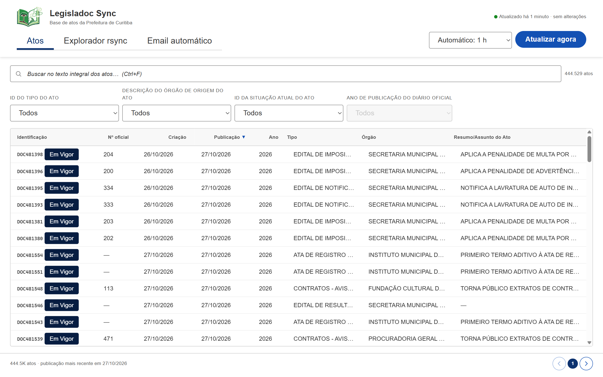
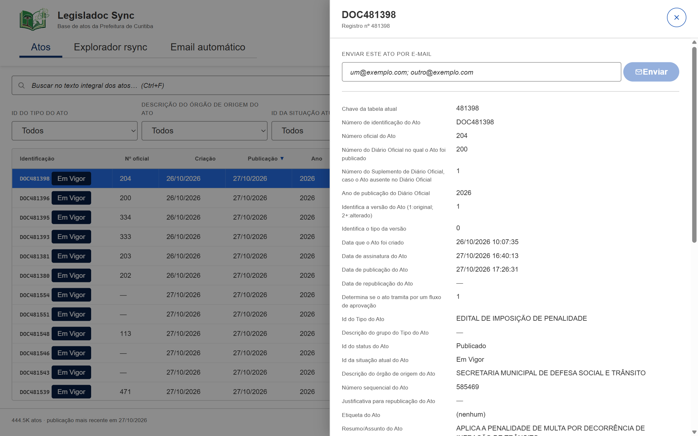
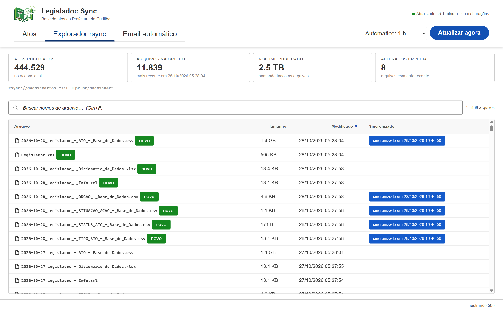
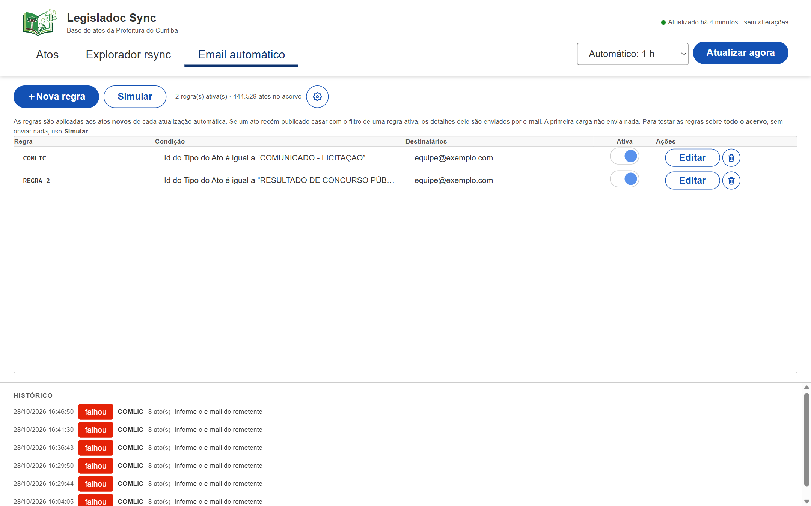

# Legisladoc Sync

**English** · [Português (BR)](README.pt-BR.md)

Desktop app to browse, search and monitor the **Legisladoc** act feed published by
the City of Curitiba. It mirrors the feed's rsync listing, keeps a local SQLite
index with full-text search, and can e-mail newly published acts that match
saved rules.



## Contents

- [How to use](#how-to-use)
  - [First run](#first-run)
  - [Atos](#atos)
  - [Explorador rsync](#explorador-rsync)
  - [Email automático](#email-automático)
  - [Gmail SMTP with an app password](#gmail-smtp-with-an-app-password)
  - [Local data and privacy](#local-data-and-privacy)
- [Developer guide](#developer-guide)
  - [Stack](#stack)
  - [Requirements](#requirements)
  - [Getting started](#getting-started)
  - [Project layout](#project-layout)
  - [How a sync works](#how-a-sync-works)
  - [Data model](#data-model)
  - [Tests](#tests)
  - [Troubleshooting](#troubleshooting)
- [Dependencies used](#dependencies-used)
- [License](#license)

## How to use

### First run

The app reads the public feed at
`rsync://dadosabertos.c3sl.ufpr.br/dadosabertos/curitiba/Legisladoc/` and mirrors
it into a local database.

1. Open **Legisladoc Sync**. The first load reads the whole act snapshot
   (roughly 1.4 GB) and indexes it, which can take a few minutes depending on
   the connection. A progress screen shows each phase: checking the source,
   reading the field definitions, downloading/indexing, and fetching new acts.
2. The status pill in the header shows what happened last: "Ainda não
   sincronizado", "Atualizado há 2 minutos · +120 atos novos", or an error
   message.
3. Choose how often the app should refresh in **Automático** (15 min, 30 min,
   1 h, 3 h or 12 h; default 1 h). **Atualizar agora** forces a refresh.
4. Subsequent refreshes are incremental: if the published act file has the same
   size and ETag, nothing is downloaded; otherwise only rows above the stored
   maximum ID are merged into the local index.

> The first load and full reloads do **not** send e-mail notifications. They
> only establish the baseline ("watermark") from which new acts are counted.

### Atos

The default tab lists published acts with full-text search.

- Type in the search box (or press `Ctrl+F`) to search the integral text of the
  acts. Matching excerpts are highlighted in the last column.
- Use the four filters — built from the feed's own field labels: act type,
  originating agency, current status and publication year — to narrow the list.
  Values and counts come from the local database. A filter stays disabled when
  the feed defines no values for that column.
- Click a column header to sort; click again to reverse. The list shows 100 acts
  per page.
- Click a row (or focus it and press `Enter`) to open the detail drawer with
  every field from the feed, the act body, and a box to send that act by e-mail.
- `Esc`/the close button dismisses the drawer.



### Explorador rsync



A raw view of what the server publishes — including files the app does not
parse — so you can check whether the local copy is current.

- Four tiles summarise the archive: published acts, files at the origin, total
  volume, and files changed in the last day.
- Search file names, sort by file/size/modified date, and look at the
  **Sincronizado** column to see which files were already ingested. Files
  changed within the last 7 days carry a **novo** tag.
- The footer shows the full path of the selected file.

### Email automático



Two concepts live here: **rules** (a saved filter with recipients and an
on/off switch) and the **SMTP settings** behind the gear button.

1. Open the gear (**Configurar servidor de e-mail**) and fill in the SMTP
   server. For Gmail, see the walkthrough below.
2. **Nova regra** creates a rule: a name, an optional full-text term, one or
   more conditions (column, operator, value, joined by `e`/`ou`), recipients
   separated by `;` or `,`, and the **Regra ativa** switch.
3. Rules run after an **automatic** sync, against the acts appended since the
   last notification. A rule that matches sends one e-mail listing up to 100
   acts; a larger match says how many were left out rather than sending
   thousands of rows.
4. **Simular** runs every enabled rule over the **whole archive** so you can
   check the filters without sending anything.
5. **Histórico** lists the last notifications per rule, including skipped and
   failed runs with their error message.

A manual refresh (**Atualizar agora**) never sends e-mail: the acts matched by
the rules appear in an in-app alert instead.

### Gmail SMTP with an app password

Gmail does not accept your normal account password over SMTP. It requires a
**16-character app password**, which in turn requires 2-Step Verification.

1. Sign in to the Google account that will send the messages.
2. Enable 2-Step Verification: <https://myaccount.google.com/security> →
   **How you sign in to Google** → **2-Step Verification**. App passwords are
   not offered while 2FA is off.
3. Open <https://myaccount.google.com/apppasswords>.
4. Enter a name such as `Legisladoc Sync` and click **Create**.
5. Copy the 16-character password shown (spaces are ignored). Google shows it
   only once; if you lose it, create another.
6. In the app, open **Email automático** → gear icon.
7. Set **Provedor** to **Google (Gmail)**. Host, port and security are filled in
   automatically: `smtp.gmail.com`, port `587`, `STARTTLS`.
8. Fill in:
   - **Usuário**: the full Gmail address (for example `name@gmail.com`).
   - **Senha**: the 16-character app password (not the account password).
   - **Remetente (nome)** and **Remetente (e-mail)**: what recipients will see.
     The e-mail should be the same account, or an alias configured in Gmail.
9. Click **Salvar**, then **Testar conexão**. A success message means the TLS
   handshake and authentication worked.
10. Type a destination in **Enviar e-mail de teste para** and click
    **Testar envio** to confirm the whole path.

Notes and limits:

- If **App passwords** is missing, the account belongs to a Google Workspace
  domain whose administrator disabled them, or Advanced Protection is on. In
  that case use a custom SMTP relay or an account that allows app passwords.
- The old "less secure app access" option no longer exists and cannot be used.
- Gmail applies daily sending quotas (free accounts: roughly 500 recipients per
  day; Workspace accounts have higher limits). Keep rules specific to stay well
  below them.
- The app password can be revoked at any time on the same Google page; delete
  it there and create a new one for the app.
- The password is stored encrypted (AES-256-GCM) in the local database, with the
  key in `email.key` beside it. This protects a copied `.sqlite` file, not a
  local attacker who can read your whole user profile.

### Local data and privacy

Everything runs locally. The app talks only to the Legisladoc feed/mirror and to
the SMTP server you configure.

- Database: `%APPDATA%\com.cwbapplab.legisladoc-sync\legisladoc.sqlite`
- Encryption key for the SMTP password: `email.key` in the same directory
- Logs: written by `tauri-plugin-log` in the application log directory
- No telemetry, analytics or third-party servers beyond those above

## Developer guide

### Stack

- **Shell:** [Tauri 2](https://tauri.app) (Rust backend + system WebView2)
- **Frontend:** React 19 + TypeScript, bundled by Vite 8
- **UI:** [GOVBR-DS](https://www.gov.br/ds/) (`@govbr-ds/core`)
- **Storage:** SQLite compiled into the binary (`rusqlite` with `bundled`),
  including FTS5 for full-text search
- **HTTP:** `ureq` with rustls (feed mirror)
- **rsync:** `arrsync`, vendored under `src-tauri/vendor/arrsync` with a small
  Windows fix
- **E-mail:** `lettre` (SMTP + STARTTLS/TLS)

### Requirements

- Windows 10/11 x64 (WebView2 runtime is preinstalled on Windows 11 and on
  up-to-date Windows 10)
- [Node.js](https://nodejs.org) 20.19+ or 22.12+ (Vite 8 requirement)
- Rust stable with the MSVC toolchain, plus the **Desktop development with C++**
  workload from Visual Studio Build Tools
- About 3 GB free disk space for the local database after the first load

### Getting started

```powershell
npm install
npm run tauri dev      # Vite on :1420 + the Tauri window
```

Other scripts:

| Command | What it does |
| --- | --- |
| `npm run dev` | Vite dev server only (front end in a browser has no Tauri IPC) |
| `npm run build` | Type-check (`tsc`) and build the front end into `dist/` |
| `npm run tauri build` | Build the installers (MSI/NSIS) into `src-tauri/target/release/bundle/` |
| `cd src-tauri; cargo test` | Rust unit/integration tests |
| `cd src-tauri; cargo test -- --ignored` | Tests that hit the live feed (network) |

### Project layout

```
.
├── src/                     React front end
│   ├── App.tsx              shell: header, tabs, status, interval, sync
│   ├── ActsView.tsx         act search, filters, table, pagination
│   ├── ActDetailDrawer.tsx  act details + "send by e-mail"
│   ├── ExplorerView.tsx     raw rsync file listing
│   ├── EmailView.tsx        SMTP settings, rules, simulation, history
│   ├── api.ts               typed wrappers over the Tauri commands
│   ├── components.tsx       GOVBR-DS controls used by the screens
│   └── styles.css           application layout on top of the design system
├── src-tauri/
│   ├── src/
│   │   ├── lib.rs           app setup, commands, background sync loop
│   │   ├── feed.rs          rsync listing (arrsync)
│   │   ├── remote.rs        HTTP HEAD/GET against the Apache mirror
│   │   ├── sync.rs          orchestration: list → schema → dimensions → acts
│   │   ├── schema.rs        `Info.xml` → tables/columns/relations
│   │   ├── parser.rs        streaming CSV parsing and value normalisation
│   │   ├── db.rs            SQLite schema, sync/rsync bookkeeping
│   │   ├── store.rs         query layer: search, facets, filters, sorting
│   │   ├── email.rs         SMTP settings, rules, watermark, delivery
│   │   └── vendor/arrsync   patched rsync client
│   ├── tauri.conf.json      window, CSP, bundling
│   └── capabilities/        Tauri permissions
└── docs/snapshots/          screenshots used in this README
```

### How a sync works

1. **List the feed over rsync.** Only metadata is transferred; the module lists
   the files and their dates/sizes. File names carry the snapshot date, so the
   newest revision of each table is selected from the listing.
2. **Read `Info.xml`.** This is the feed's own description of the CSV layout.
   The act and dimension tables are created from it, so a snapshot that adds or
   renames a column is stored correctly instead of silently truncated.
3. **Replace the dimension tables** (`ORGAO`, `TIPO_ATO`, `SITUACAO_ACAO`, …).
   They are a few KB each, so a wholesale replace avoids diffing.
4. **Import the act snapshot.** `HEAD` the file: if size and ETag match the last
   imported revision, the refresh stops there. Otherwise the CSV is streamed
   into a staging table (`acts_import`), the rows whose `ID` is above the stored
   maximum are merged into `acts`, the FTS5 index is updated, and the staging
   table is dropped.
5. **Notify.** After an automatic sync, enabled e-mail rules run against the
   newly appended acts (watermark-based). A manual sync shows the matches in the
   UI and sends nothing.

Progress is emitted as events (`sync-started`, `ingest-progress`,
`sync-complete`, `sync-matches`) so long first loads show a real progress screen.

### Data model

| Table | Purpose |
| --- | --- |
| `acts` | Act records, columns generated from `Info.xml` |
| `acts_fts` | FTS5 index over the act header/body |
| `acts_import` | Staging table for a downloaded snapshot (temporary) |
| dimension tables | `ORGAO`, `TIPO_ATO`, `SITUACAO_ACAO`, … from the feed |
| `rsync_files` | Last rsync listing (path, size, mtime, ingest time) |
| `syncs` | History of refreshes, with errors |
| `email_settings` | Single row: SMTP configuration (encrypted password) |
| `email_rules` | Saved filters + recipients + enabled flag |
| `email_log` | Per-rule notification history |
| `email_state` | Watermark: highest act ID already notified about |

### Tests

```powershell
cd src-tauri
cargo test
```

The suite covers CSV parsing, schema generation, filtering/sorting validation,
watermark behaviour and sync orchestration. Network tests are marked `#[ignore]`
and can be run with `cargo test -- --ignored` when online.

### Troubleshooting

- **Port 1420 already in use** — another Vite/Tauri dev instance is running.
  Stop it; `vite.config.ts` uses `strictPort`.
- **`cargo` cannot find a linker** — install Visual Studio Build Tools with the
  C++ workload and reopen the terminal.
- **Blank window / connection refused** — `npm run tauri dev` starts Vite; if
  the window opens before it, reload with `Ctrl+R`.
- **First load looks stuck** — the status pill and the preparation screen show
  the current phase. A 1.4 GB download over a slow link takes a while; the
  transfer timeout is 30 minutes.
- **Gmail returns `535 5.7.8 Username and Password not accepted`** — you used
  the account password instead of an app password, or 2FA is off. Recreate the
  app password and paste it again.
- **Database locked** — close other instances of the app; SQLite allows one
  writer at a time.

## Dependencies used

The full inventory — 475 Rust crates and 36 npm packages, with versions,
license expressions, copyright notices and the full text of every license — is
in [THIRD-PARTY-NOTICES.md](THIRD-PARTY-NOTICES.md) (and in Portuguese in
[THIRD-PARTY-NOTICES.pt-BR.md](THIRD-PARTY-NOTICES.pt-BR.md)).

Main runtime dependencies:

| Dependency | Used for |
| --- | --- |
| `tauri` / `tauri-plugin-log` | Desktop shell, IPC commands, logging |
| `rusqlite` (`bundled`) | SQLite storage and FTS5 full-text index |
| `ureq` (+ `rustls`) | HTTP access to the feed's Apache mirror |
| `arrsync` (vendored) | rsync protocol listing |
| `roxmltree` | Parsing the feed's `Info.xml` schema |
| `encoding_rs` | Decoding the CSV files' character set |
| `tokio` | Async runtime for rsync/HTTP work |
| `chrono`, `url`, `anyhow`, `log` | Dates, URLs, error handling, logging |
| `lettre` | SMTP delivery (STARTTLS/TLS) |
| `aes-gcm` | Encrypting the stored SMTP password |
| `react`, `react-dom` | UI |
| `@tauri-apps/api` | Front end ↔ backend bridge |
| `@govbr-ds/core` | GOVBR-DS design system |

Build and development: `vite`, `@vitejs/plugin-react`, `typescript`,
`@types/react`, `@types/react-dom`, `@tauri-apps/cli`, `tauri-build`.

## License

MIT — Copyright (c) 2026 cwbapplab. See [LICENSE](LICENSE) for the license and
the additional **"AS IS"** disclaimer. Third-party components keep their own
licenses; see [THIRD-PARTY-NOTICES.md](THIRD-PARTY-NOTICES.md).
